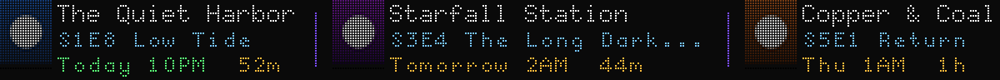
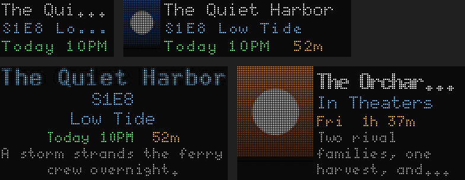

# Upcoming Episodes & Movies

What's coming out next, on your LED matrix: new TV episodes from **Sonarr**
(or **Jellyfin**) and movie releases from **Radarr**, with the show's logo or
poster, `S3E4`, the episode name, air date and time, runtime and a short
description.

*All screenshots use made-up shows and synthetic artwork from the plugin's test
fixtures.*

## Which source should I use?

| You run | Episodes come from | Movies come from |
|---|---|---|
| Sonarr + Radarr (best) | Sonarr calendar | Radarr calendar |
| Jellyfin only | Jellyfin "Upcoming" | *(none)* |
| Jellyfin + Radarr | Jellyfin "Upcoming" | Radarr calendar |

- **Sonarr** knows real air times, runtimes and overviews for every monitored
  show, including ones you have not downloaded yet.
- **Jellyfin** only lists unaired episodes of series already in your library,
  and only knows the air *date*, not the time. It has no concept of an
  unreleased movie, so upcoming movies need **Radarr**.
- When both Sonarr and Jellyfin are set up, Sonarr wins (change it with
  `episode_source`).

## Minimal setup

In the web UI, open **Plugins → Upcoming Episodes & Movies**, enable it, and
fill in **one** server:

| Server | URL example | Where to find the API key |
|---|---|---|
| Sonarr | `http://192.168.1.50:8989` | Settings → General → Security → API Key |
| Radarr | `http://192.168.1.50:7878` | Settings → General → Security → API Key |
| Jellyfin | `http://192.168.1.50:8096` | Dashboard → API Keys → **+** |

If Sonarr or Radarr sit behind a URL base (`/sonarr`), include it in the URL.
For Jellyfin you can limit the plugin to some libraries with
`jellyfin_libraries` (for example `TV Shows`). Leave it empty to use all of
them.

API keys are saved to `config/config_secrets.json` on the Pi, never to the
main config.

## Screens and modes

The plugin adds two screens to the rotation, **upcoming-episodes** and
**upcoming-movies**. Turn either off with `show_episodes` / `show_movies`. A
screen with nothing in the window is skipped (set `show_empty_message` to show
"No upcoming episodes" instead).

- **Switch** (default) shows one item at a time for `switch_duration` seconds.
  A title or episode name that is too long scrolls sideways (`marquee_enabled`),
  and its card stays up until the text has scrolled all the way through once
  (up to 3x `switch_duration`). The screen stays until every item has been
  shown once.
- **Scroll** runs every item past as a ticker, each card only as wide as its
  content.

- **Vegas**: in the core's Vegas mode, every item joins the marquee as its own
  card (`vegas_mode: static` pauses the marquee on this plugin instead).

## Scales to the panel

The layout picks fonts and artwork from the panel size:

- **Short panels** (32 px tall) draw the poster on the left with three
  lines: title, episode number and name, and date/runtime. The description
  shows on taller panels (or pick a smaller font under Customization).
- **Tall panels** (64 px and up) put the show's logo across the top (it
  replaces the title line) with larger fonts and more lines of description.
  Without a logo, the poster is used.
- Lines are dropped lowest-priority first when space runs out: description,
  then date. "Season 3 Episode 4" falls back to "S3E4" when it does not fit,
  and the episode name gets its own line when there is room.
- Dim logos (a dark-green or grey wordmark made for a TV screen) are
  brightened. A logo that is still unreadable on the panel, such as black art
  or hairline letters, is replaced by the poster.
- Back-to-back episodes of a show on the same day (a double bill, a whole
  season dropping at once) share one card: `S3E5-6`, "2 episodes".

## Settings

Main settings:

| Setting | Default | What it does |
|---|---|---|
| `sonarr_url` / `sonarr_api_key` | – | Sonarr server (episodes) |
| `radarr_url` / `radarr_api_key` | – | Radarr server (movies) |
| `jellyfin_url` / `jellyfin_api_key` | – | Jellyfin server (episodes when Sonarr is not set) |
| `jellyfin_libraries` | `[]` (all) | Jellyfin library names to include |
| `show_episodes` / `show_movies` | `true` | Which screens appear |
| `display_mode` | `switch` | `switch` (one at a time) or `scroll` (ticker) |
| `window` | `upcoming_list` | `upcoming_list` = everything in the window; `next_per_show` = each show's next episode only |
| `days_ahead` | `7` | Days to look ahead (7 = this week, 0 = today only) |
| `show_episode_title` | `true` | Episode name |
| `show_description` | `true` | Short description (first sentence) |
| `show_date` | `true` | Release date / air time |
| `show_runtime` | `true` | Runtime, e.g. `45m`, `2h 5m` |
| `episode_format` | `compact` | `compact` S3E4, `padded` S03E04, `long` Season 3 Episode 4 |
| `image_type` | `auto` | `auto`, `logo`, `poster`, or `none` |
| `display_duration` | `30` | Seconds per screen in scroll mode when dynamic duration is off |

Advanced settings:

| Setting | Default | What it does |
|---|---|---|
| `jellyfin_username` | first admin | Jellyfin user whose libraries are read |
| `episode_source` | `auto` | `auto` (Sonarr if set), `sonarr`, `jellyfin` |
| `movie_release_types` | all | Radarr dates that count: `cinema`, `digital`, `physical` |
| `include_unmonitored` | `false` | Include unmonitored Sonarr/Radarr items |
| `include_aired_today` | `true` | Keep today's episodes after they air |
| `include_downloaded` | `true` | Keep items already downloaded |
| `group_episodes` | `true` | One card for back-to-back episodes on the same day (`S3E5-6`) |
| `max_items` | `10` | Most items per screen |
| `description_max_chars` | `60` | Description length before it is cut at a word |
| `date_format` | `relative` | `relative` (Today 9PM / Tomorrow / Thu / Nov 24), `short`, `numeric` |
| `time_format` | `12h` | `12h` or `24h` |
| `highlight_today` | `true` | Today's dates in the Today color |
| `show_empty_message` | `false` | Show a message instead of skipping an empty screen |
| `switch_duration` | `6` | Seconds per item in switch mode |
| `marquee_enabled` | `true` | Scroll long titles in switch mode (the card waits for the scroll to finish) |
| `scroll_speed` / `scroll_delay` | `1.0` / `0.02` | Scroll mode: pixels per frame / seconds per frame |
| `dynamic_duration` | on, 15–180 s | Scroll mode: stay until every item has passed |
| `vegas_mode` | `scroll` | `scroll` joins the Vegas marquee; `static` pauses it |
| `update_interval` | `900` | Seconds between calendar refreshes |

**Customization**: `title_text`, `episode_text`, `date_text` and
`description_text` each have a `font` (`auto` picks one for the panel size), a
`font_size` (`0` = automatic) and a `text_color`. There are also `today_color`,
`accent_color` (the divider between scroll cards) and `background_color`.
Bitmap `.bdf` fonts always draw at their own size. `4x6-font.ttf` is crisp at
multiples of 7 and `PressStart2P` at multiples of 8.

## How it works

- The calendars are fetched in the background every `update_interval` seconds
  and cached. If a server is unreachable, the last list stays on screen. If
  nothing has been fetched yet, a short error shows instead (`Sonarr: offline`,
  `Radarr: bad API key`).
- Artwork is downloaded once per show, from Sonarr/Radarr's own MediaCover
  copy (so it works without internet access), and kept in the LEDMatrix cache
  for a week.
- A date-only release (Radarr, Jellyfin) shows the date without a time and is
  never shifted to the previous day by your timezone.
- Times are shown in the timezone set in LEDMatrix's general settings.

## Requirements

LEDMatrix core 3.8.0 or newer. Python packages: `requests`, `Pillow`.
